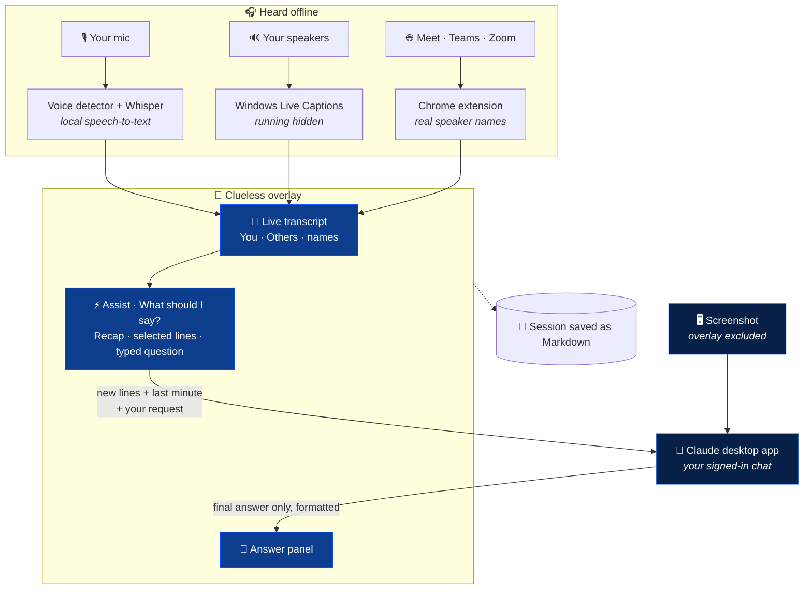
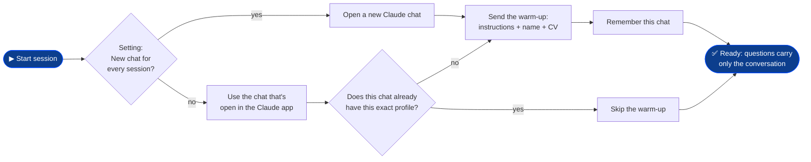
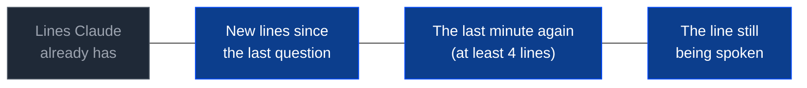
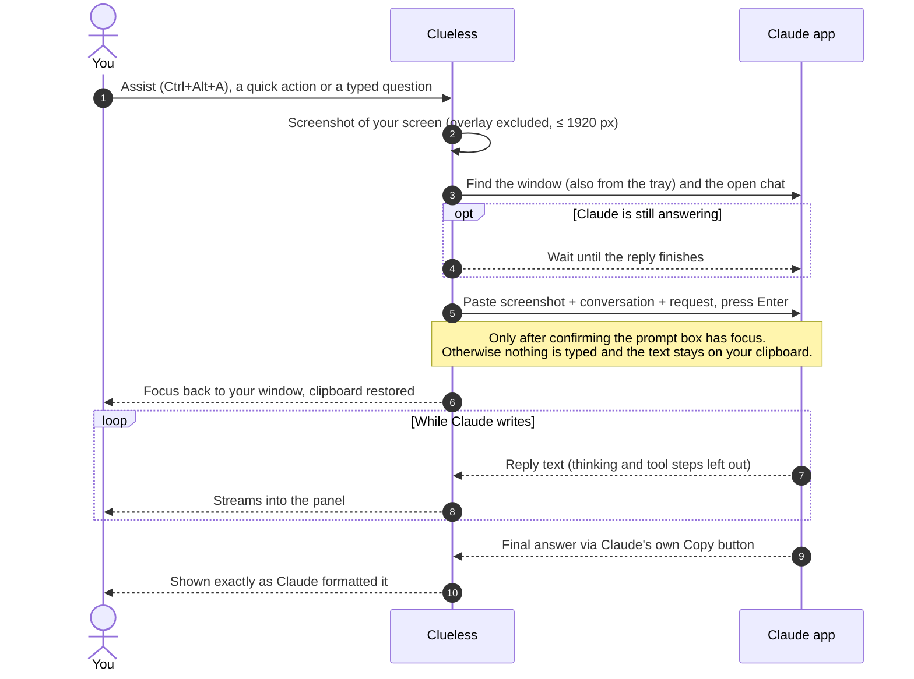

# Clueless

**The seamless, open-source Cluely alternative.**
*Looks clueless. Isn't.*

An invisible copilot for interviews, meetings and calls on Windows: it listens, keeps the transcript,
sees your screen, and gets you Claude's answer before the pause gets awkward.

### [⬇ Download for Windows](https://github.com/a0x0h/Clueless/releases/latest)

 

---

## Why Clueless

| | |
|---|---|
| **Invisible** | The overlay is excluded from screen shares, recordings, screenshots and the taskbar. |
| **Hears both sides** | Your mic is transcribed offline with Whisper; everyone else comes from Windows Live Captions. |
| **Knows you** | Your name, CV and instructions are given to Claude once when a session starts, so every answer is about *you*. |
| **Sees your screen** | Each question can carry a screenshot of the screen you're on (the overlay never appears in it). |
| **Clean answers** | You get Claude's final answer with its formatting (bold, lists, tables), never its thinking steps. |
| **No accounts, no keys** | It drives the Claude desktop app you're already signed in to. Nothing else leaves your PC. |
| **Everything saved** | Each session is saved as Markdown: transcript plus every question and answer. |

## Quick start

1. Install the **Claude desktop app** and sign in.
2. Download **`Clueless-x.y.z-win-x64.zip`** from [Releases](https://github.com/a0x0h/Clueless/releases/latest), unzip it anywhere and run `Clueless.exe`. Nothing to install. (Windows SmartScreen may ask once: *More info → Run anyway*.)
3. Open **Settings → Your profile** and add your name, your CV (paste it, or *Load from file…* for `.txt`, `.md` or `.docx`) and any instructions.
4. In the Claude app, open the chat you want Clueless to use. Then press **▶ Start session**.

<b>Build from source</b>

Run `build.cmd`. It uses the C# compiler built into Windows (no SDK) and downloads, once:
- the WebView2 SDK (Microsoft, nuget.org),
- whisper.cpp `b5454` (github.com/ggml-org) and two English Whisper models (huggingface.co/ggerganov, 56 MB + 181 MB).

`scripts\package.ps1` builds the release zip into `dist\`.

## How it works

Everything is heard and transcribed on your PC. Only the conversation, and a screenshot when you allow it, go to the Claude app, and only when you ask.

### Sessions and the warm-up

When a session starts, Clueless gives Claude one **warm-up** message with your instructions, name and CV. After that, questions carry only the conversation, so they're short and fast.

- Changed your CV mid-session? Logo menu → **Give Claude my profile again**.

### What Claude sees with each question

The blue part is sent with **Assist**, **What should I say?**, **Follow-up questions** and typed questions, so a question split across caption lines, or not finished yet, arrives whole. **Recap** sends the whole transcript. With lines selected, those lines are quoted as the focus too.

**Assist** answers the latest question the other side asked, in your voice; with nothing being asked, it tells you what's useful right now.

## Using it

**The pill** sits at the top center of your screen. Drag it, or the panel's top bar, to move everything.

- Logo → menu: settings, saved sessions, stealth, copy transcript, give Claude your profile again, quit.
- **▶ Start session** begins listening. While live, it shows a timer. **■** stops and saves.
- **Hide / Show** collapses the panel.

**Assist tab:** Claude's answers. "Viewed screen" means a screenshot was attached.

**Transcript tab:** every sentence, labeled by speaker.
- **Click** lines to select them, **Shift+click** to select a range. A bar appears: *How should I respond?* · *Explain* · or type your own question about them.
- Hover a line and press **Ask** to ask about just that line.
- Click a speaker's name to rename them.

| Shortcut | |
|---|---|
| `Ctrl+Alt+A` | Assist |
| `Ctrl+Alt+S` | What should I say? |
| `Ctrl+Alt+H` | Show / hide everything |
| `Ctrl+Enter` | Assist (in the panel) |
| `Esc` | Clear the selection, close menus |

### Speaker names

| Situation | Labels |
|---|---|
| Google Meet / Teams / Zoom in Chrome (captions on + extension) | Real names: `Alex`, `Abi` |
| Any other app or site | `You` (your mic) vs `Others` (your speakers) |

To get real names: open `chrome://extensions`, turn on **Developer mode**, **Load unpacked** → choose the `extension` folder, and turn on captions (CC) in the meeting.

Use headphones: without them the mic also hears the speakers. Clueless drops mic sentences that echo what the speakers just said, but headphones are cleaner.

## How a question reaches Claude

## Saved sessions

Each session is saved as Markdown in `Documents\Clueless Sessions\` (for example `2026-10-28 14.05.md`): the timestamped transcript by speaker, and every question with Claude's answer, in time order. The file is rewritten every few seconds, so nothing is lost if the PC goes down.

## Window

- See-through: only the pill and panel take clicks; everything around them clicks through.
- **Stealth** (default on): excluded from screen capture and the taskbar.
- Per-monitor DPI aware.
- One copy at a time: starting it again brings the running copy into view.
- Flags: `--no-stealth` (to take screenshots of the app), `--dev` (DevTools).

## Troubleshooting

| Problem | Fix |
|---|---|
| Your voice doesn't show up | `%APPDATA%\Clueless\mic.log` shows the mic level, detected sentences and transcriptions. Check Windows' microphone privacy settings. |
| Accents / noisy room | Settings → **Higher accuracy for my voice** (Whisper `small.en`, about 3× slower). |
| Others are labeled as you | In Live Captions settings, leave **Include microphone audio** off. |
| Questions go to the wrong chat | Open the right chat in the Claude app before you start the session, or turn on **New Claude chat for every session**. |

## Project layout

| Path | |
|---|---|
| `Clueless.cs` | The app: window and stealth, sessions and session file, Live Captions reader, offline mic channel, meeting-caption listener (`localhost:47321`), Claude-app bridge. |
| `ui/` | The interface (HTML/CSS/JS). Edit and restart; no rebuild needed. Serving `ui/` from a local web server shows it with sample data. |
| `extension/` | Chrome extension for Meet, Teams and Zoom captions with names. |
| `build.cmd` | One-step build, no SDK needed. |
| `scripts/package.ps1` | Packs the release zip. |
| `assets/` | Logo and app icon. |

Contributions are welcome, see [CONTRIBUTING.md](CONTRIBUTING.md). Changes are listed in [CHANGELOG.md](CHANGELOG.md).

Settings live in `%APPDATA%\Clueless\` (carried over from the app's former name, *Caption → Claude*).

## Responsible use

Clueless is a note-taking and thinking aid. Recording or transcribing people may require their consent where you live, and many interviews, exams and meetings have rules about assistance. Follow them.

## License

[MIT](LICENSE)
